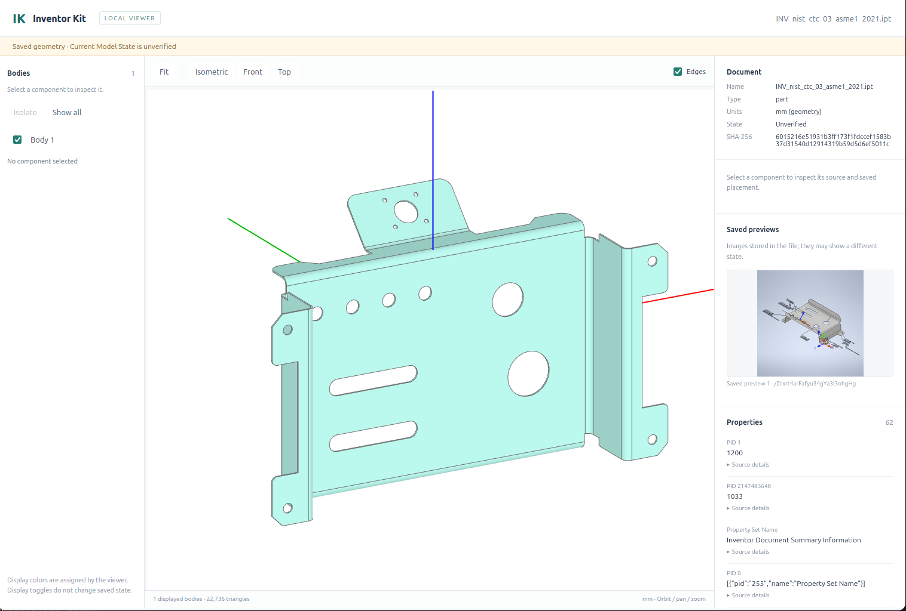

# inventor-kit

[English](README.md) | 日本語

Autodesk Inventor の文書情報と保存済み部品形状を Rust で読み、Python から利用する
ライブラリです。対応する形状を `cq_acis.AcisModel` と CadQuery に接続できます。
実行時のネット接続、Inventor、Windows、ユーザー提供スキーマは不要です。

```text
IPT → CFB / RSe → 保存された SAB / ASM → acis-core → AcisModel → CadQuery
IAM → 保存参照・配置 → ローカル部品解決 → CadQuery Assembly
```

このライブラリは確認済みプロファイルの限定パーサです。現在の Model State、
フィーチャ履歴の再評価、未対応形状の独自の近似は行いません。手続き的な曲線・曲面と
一緒にファイルへ保存された B-spline 近似は、派生形状として使い、警告として報告します
（[body変換](docs/body-conversion.ja.md)）。

IDW を Viewer で開くと、保存済みのシートを表示できます。シート単位で SVG に書き出すこともできます。
図面は実験的な部分対応で、実寸精度と Inventor 表示との一致は未検証です。詳しくは[図面ガイド](docs/drawing.ja.md)を参照してください。

## インストール

Python 3.11 以降、`cq-acis>=0.4.2,<0.5`、共通モデル API 2 を使用します。
`pip install inventor-kit` でパーサと共通モデルが入ります。形状を変換する場合は、
次の二つから一方を選んでください。それぞれ同じ `OCP` モジュールの別ビルドをインストールします。

```sh
python -m pip install 'inventor-kit[cadquery]'  # CadQuery の形状、STEP 出力、IAM、writer
python -m pip install 'inventor-kit[occt]'      # CadQuery なしで OCCT の形状だけ
```

ソースビルドには Rust 1.93 と maturin、および `acis-core` / `acis-py-bridge`
0.4.2 を crates.io から取得します。[開発・検証手順](docs/development.ja.md)と
[リリース条件](docs/releasing.ja.md)を参照してください。

## 部品の読み込み

```python
import inventor_kit as ik
import cadquery as cq

doc = ik.read_file("part.ipt")
print(doc.summary["status"], doc.summary["diagnostics"])
if doc.model is not None:
    shape = doc.to_cadquery()  # 未対応の曲面・トリムなどは例外
    cq.exporters.export(shape, "part.step")
```

属性だけが必要な場合は、Python の形状モジュールを import しない `inspect_file` を使います。

```python
info = ik.inspect_file("part.ipt").metadata
for prop in info.find_properties(semantic_name="part_number"):
    print(prop.value, prop.source.stream, prop.state_binding)
```

```sh
python -m inventor_kit part.ipt
python -m inventor_kit part.ipt --step part.step
python -m inventor_kit drawing.idw --metadata-only
python -m inventor_kit part.ipt --list-candidates
```

部品形状やアセンブリの保存配置をローカルで確認するには、追加機能の [viewer](docs/viewer.ja.md) を導入します。

```sh
python -m pip install 'inventor-kit[viewer]'
python -m inventor_kit.viewer part.ipt
```



表示モデル: [NIST CTC 03](https://www.nist.gov/ctl/smart-connected-systems-division/smart-connected-manufacturing-systems-group/mbe-pmi-0)（保存済み形状）。

## アセンブリの読み込み

```python
assembly = ik.read_assembly_file("assembly.iam", search_roots=["parts"])
converted = assembly.to_cadquery(allow_unverified_state=True, allow_partial=True)
print(converted.omissions, converted.reference_issues)
report = converted.export_step("assembly.step", allow_partial=True)
```

保存配置の利用は明示的に許可します。欠落部品や未対応形状は結果に残し、
現在状態が未検証のため `complete` は `False` です。
STEP 出力は既存ファイルを上書きせず、出典・欠落情報を付属 JSON に保存します。

## 上限と対応範囲

```python
limits = ik.Limits(max_file_bytes=32 * 1024 * 1024, max_candidates=16)
doc = ik.read_file("part.ipt", limits=limits)
print(ik.capabilities())
```

上限は文書ごとに引き下げられます。プロセスのメモリ・実行時間や OCCT の計算量を
保証するものではありません。既定値、診断、保存候補の選び方は [API ガイド](docs/api.ja.md)を参照してください。

| 資料 | 内容 |
| --- | --- |
| [対応範囲](docs/support.ja.md) | 形式プロファイル、形状・状態・アセンブリの制限 |
| [API ガイド](docs/api.ja.md) | 属性、保存候補、単位、参照解決、上限 |
| [CLI](docs/cli.ja.md) | IPT/IAM のバッチ変換、IDW のシート一覧・レポート |
| [検証](docs/validation.ja.md) | 回帰・保留検証、比較の根拠、実行済み範囲 |
| [開発](docs/development.ja.md) | ビルド、テスト、fuzz、公開ディレクトリの役割 |
| [実験段階のpart writer](docs/part-writer.ja.md) | CadQuery・STEPから単独IPTを生成 |
| [リリース](docs/releasing.ja.md) | wheel / sdist、CI、公開前の条件 |
| [変更履歴](CHANGELOG.md) | 未リリースの変更とリリースノートの案内 |
| [形式資料](docs/format-reference.ja.md) | 実装に使用した資料とライセンス |

生成したIPTをIAMにまとめる `new_assembly` / `write-assembly` は[アセンブリwriter](docs/assembly-writer.ja.md)を参照してください。APIの `target_year`／CLIの `--target-year` で2026または2027を選択できます（既定2027）。両版の限定profileで、実機の保存・再読込・移動後の参照解決まで検証済みです。

公開サンプルは hash と出典を固定して検証し、CAD ファイル自体は配布パッケージに含めません。

## ライセンス

現行の inventor-kit 配布物は **[PolyForm Noncommercial 1.0.0](licenses/PolyForm-Noncommercial-1.0.0.md)** で提供しています。
PolyForm の許諾範囲外の利用については、UnRobotics Inc. が別途
[商用ライセンス](COMMERCIAL-LICENSE.md)を提供しています。
適用範囲、過去の MIT 許諾、第三者コンポーネントの条件は、
[ライセンス詳細](docs/license.ja.md)を参照してください。

Required Notice: inventor-kit is licensed by UnRobotics Inc. (https://www.un-robotics.com/).

Required Notice: This inventor-kit release is offered under PolyForm Noncommercial 1.0.0 or a separate commercial agreement; earlier MIT permissions and third-party terms remain in effect.
